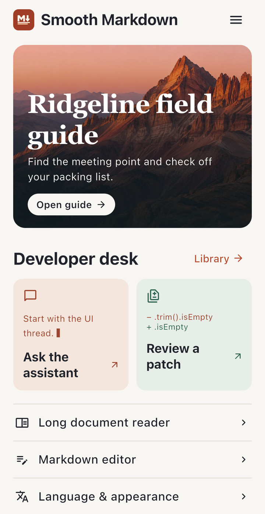
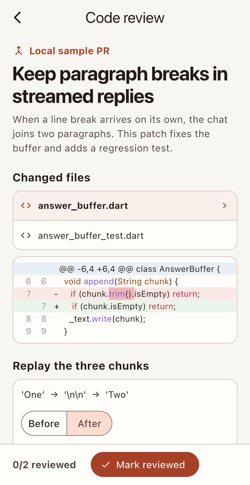
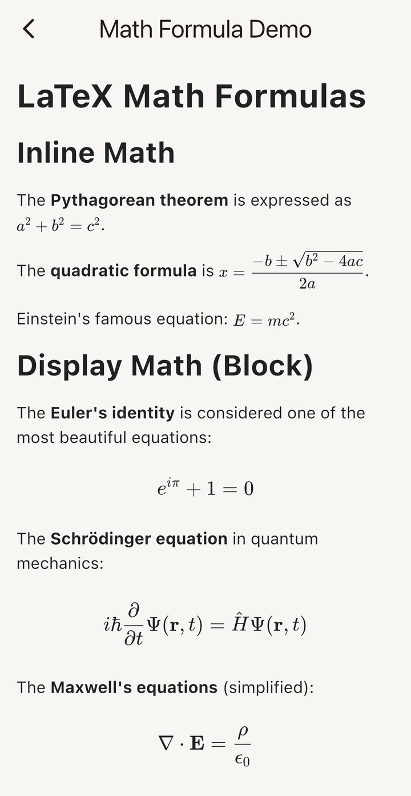
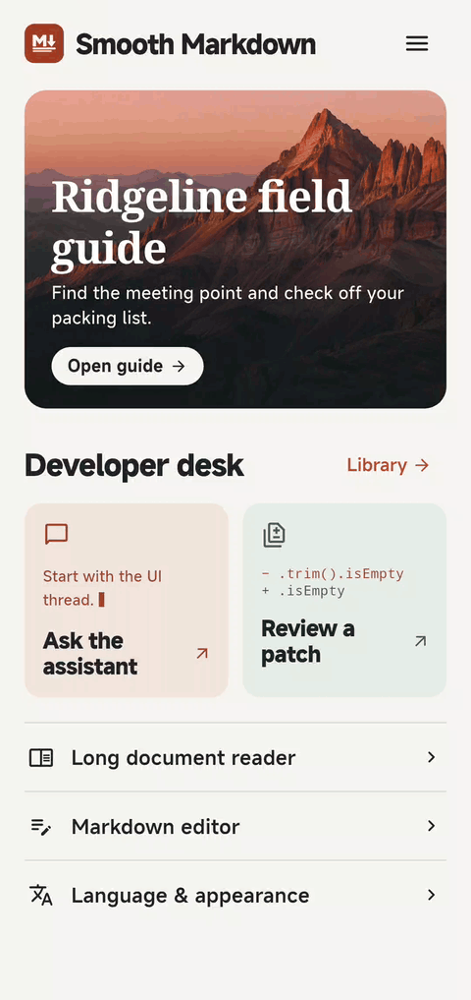

# Flutter Smooth Markdown


[](https://pub.dev/packages/flutter_smooth_markdown)
[](https://pub.dev/packages/flutter_smooth_markdown/score)
[](https://pub.dev/packages/flutter_smooth_markdown/score)
[](https://github.com/JackCaow/flutter-smooth-markdown/stargazers)
[](https://github.com/JackCaow/flutter-smooth-markdown/network/members)
[](https://github.com/JackCaow/flutter-smooth-markdown/issues)
[](https://github.com/JackCaow/flutter-smooth-markdown/blob/main/LICENSE)
[](https://flutter.dev)
[](https://dart.dev)

A high-performance Flutter markdown renderer with syntax highlighting, LaTeX math, tables, footnotes, SVG images, Mermaid diagrams, and real-time streaming support.

## Upgrading from 0.10.0 to 0.11.0

| Use case | 0.10.0 | What changes in 0.11.0 |
| --- | --- | --- |
| Reading a long document | `SmoothMarkdown` builds the document in one box. | Use `SmoothMarkdown.sliver(data: text)` in a vertical `CustomScrollView` to build only the blocks in or near the viewport for eligible documents. Whole-document selection keeps the full layout. |
| Streaming a chat answer | `StreamMarkdown` reparses the accumulated text as chunks arrive. | The existing widget reuses completed blocks on eligible Dart and Rust streams and reparses the changing tail. Use `StreamMarkdown.sliver(stream: chunks)` to also build blocks on demand. |
| Reviewing code | Markdown code fences support syntax highlighting. | Embed `MarkdownCodeView` for source or `MarkdownDiffView` for a unified patch with old and new line numbers, highlighted additions and deletions, and highlighted word changes within paired lines. |

On an iPhone 17, a document with 435,200 UTF-16 units and 8,000 blocks showed its first heading in **749 ms with the box and 52 ms with the sliver** using Dart, or **731 ms and 64 ms** using Rust. Both slivers initially mounted 15 blocks. Each configuration opened the document once in a fresh process of the same profile build of the release candidate. [Benchmark and raw samples](https://github.com/JackCaow/flutter-smooth-markdown/blob/5ef6d34c91f06c2674802926101dc46f4f277551/benchmarks/static-document-results.md)

Existing box constructors remain available. The minimum SDKs rise from Flutter 3.0 and Dart 3.0 to **Flutter 3.38 and Dart 3.10**. Native builds also require Rust, Cargo and the target for the platform. Web uses Dart. [Build requirements and migration](https://github.com/JackCaow/flutter-smooth-markdown/blob/5ef6d34c91f06c2674802926101dc46f4f277551/docs/rust-core.md)

## Features

| Category | Features |
|----------|----------|
| **Rendering** | AST-based parsing, syntax highlighting, real-time streaming, text selection |
| **Editing** | Formatted/source/preview/split editor, formatting toolbar, slash commands, wikilinks, find |
| **Markdown** | Headers (with inline formatting), lists, tables, code blocks, blockquotes, links, images |
| **Math & Charts** | LaTeX formulas, Mermaid diagrams (flowcharts, Gantt, Kanban, Timeline, Radar, XY Chart, pie, sequence) |
| **Extras** | Footnotes, SVG support, collapsible sections, task lists, whitelisted HTML tags (opt-in) |
| **Theming** | Light/dark modes, GitHub/VS Code presets, custom themes |
| **Plugins** | Mentions, hashtags, emojis, AI chat blocks (thinking, artifacts) |

## Demo

<table>
<tr>
<td></td>
<td></td>
<td></td>
</tr>
<tr>
<td align="center">Example home</td>
<td align="center">Patch review</td>
<td align="center">LaTeX formulas</td>
</tr>
</table>

**Streaming an answer on Android**



> Run the example app: `cd example && flutter run`
>
> Run the editor preview directly in Chrome: `cd example && flutter run -d chrome -t lib/editor_preview_main.dart`
>
> The example home screen opens the long-document reader and Markdown editor. The Library contains the syntax and plugin demos.

## Shared core, source highlighting and diff

Native builds use the pinned Rust parser and highlighter behind the Flutter APIs. [Shared Rust core](https://github.com/JackCaow/smooth-rust-core)

Open **Long document reader** in the example to scroll the benchmark sample or paste your own Markdown.
See the [435k streaming comparison](https://github.com/JackCaow/flutter-smooth-markdown/blob/main/benchmarks/stream-eligibility-results.md),
[block layout comparison](https://github.com/JackCaow/flutter-smooth-markdown/blob/main/benchmarks/block-layout-results.md),
[CPU and memory results](https://github.com/JackCaow/flutter-smooth-markdown/blob/main/benchmarks/sustained-rss-results.md)
and [Dart/Rust incremental comparison](https://github.com/JackCaow/flutter-smooth-markdown/blob/main/benchmarks/equal-incremental-results.md).

```dart
MarkdownCodeView(code: source, language: 'dart');
MarkdownDiffView(patch: unifiedDiff, language: 'dart');
final tokens = MarkdownCore.highlightedCode(source, language: 'App.tsx');
final rows = MarkdownCore.highlightedDiff(unifiedDiff, language: 'dart');
```

The example's **Code & Diff** page demonstrates both views, semantic colors,
line numbers, dark themes, and `diff dart` fenced blocks.

## Quick Start

Building a native app? See the [iOS and Android API map](https://github.com/JackCaow/flutter-smooth-markdown/blob/main/docs/native-api-map.md) for equivalent entry points and current differences.

### Installation

```yaml
dependencies:
  flutter_smooth_markdown: ^0.11.0
```

```bash
flutter pub get
```

### Basic Usage

```dart
import 'package:flutter_smooth_markdown/flutter_smooth_markdown.dart';

SmoothMarkdown(
  data: '# Hello Markdown\n\nThis is **bold** and *italic*.',
  styleSheet: MarkdownStyleSheet.light(),
  onTapLink: (url) => print('Tapped: $url'),
)
```

### Selectable Text

```dart
SmoothMarkdown(
  data: markdownText,
  selectable: true,
  onTapImage: (url, alt, title) {
    showImagePreview(context, url);
  },
)
```

Selection handles work across text and non-text blocks (images, tables, etc.). Copied content is automatically cleaned.

### Markdown Editor

```dart
import 'package:flutter_smooth_markdown/flutter_smooth_markdown_editor.dart';

final editorController = MarkdownEditorController(
  text: '# Scratch note',
  historyLimit: 200,
);

SmoothMarkdownEditor(
  controller: editorController,
  mode: MarkdownEditorMode.formatted,
  wikilinkSuggestions: const ['Daily Notes', 'Project Plan'],
  capabilities: const MarkdownEditorCapabilities(
    disabledCommands: {
      MarkdownEditorCommand.mermaidDiagram,
      MarkdownEditorCommand.blockMath,
    },
  ),
  toolbarCommands: const [
    MarkdownEditorCommand.bold,
    MarkdownEditorCommand.italic,
    MarkdownEditorCommand.link,
    MarkdownEditorCommand.image,
    MarkdownEditorCommand.codeBlock,
    MarkdownEditorCommand.table,
  ],
  toolbarTrailing: [
    IconButton(
      tooltip: 'Save',
      icon: const Icon(Icons.save_outlined),
      onPressed: () {
        saveDraft(editorController.text);
        editorController.markSaved();
      },
    ),
  ],
  onChanged: (markdown) => saveDraft(markdown),
  onCommand: (command) => analytics.track('markdown_command', command.name),
  onSelectionChanged: (selection) => updateSelectionState(selection),
  onTapWikilink: (target) => openNote(target),
  onExportMarkdown: (markdown) => saveMarkdownFile(markdown),
)
```

`SmoothMarkdownEditor` keeps Markdown source as the document of record and renders
the preview with `SmoothMarkdown`. It includes Scratch-inspired editor controls:
formatting commands, `Cmd/Ctrl+B`, `Cmd/Ctrl+I`, `Cmd/Ctrl+K`, `Cmd/Ctrl+F`,
`Cmd/Ctrl+Shift+M`, `Cmd/Ctrl+Shift+Enter`, `/` commands, `[[wikilink]]`
autocomplete, formatted block editing, code-block language selection, Mermaid
preview/source toggling, block math editing, copy-as-Markdown/plain-text/HTML,
Markdown import/export callbacks, focus mode, and source, preview, or split layouts.

Host apps can treat `MarkdownEditorController` as the stable integration point:
use `text` for the Markdown source, `isDirty`/`markSaved()` for save state,
`selection`/`getSelectionMarkdown()` for source selections, `insertMarkdown()`
or `replaceSelection()` for integrations, `undo()`/`redo()` for custom UI, and
the table helpers (`replaceTableCellText`, `insertTableRowAfter`,
`insertTableColumnBefore`, `setTableColumnAlignment`, etc.) for host table
controls. Use controlled `mode` + `onModeChanged` when the app owns editor
layout, `MarkdownEditorCapabilities` to disable built-in commands,
`toolbarCommands` to hide or reorder the built-in toolbar buttons,
`toolbarLeading`/`toolbarTrailing` to add host actions, `toolbarBuilder` to wrap
or replace the toolbar, `enableKeyboardShortcuts` to turn off built-in
shortcuts, and `onShortcut` to intercept keys before the editor handles them.

Editor chrome can be styled without forking the widget. Pass
`editorTheme: MarkdownEditorThemeData(...)` to one editor, or install the same
theme globally through `ThemeData.extensions`. The editor theme covers toolbar
colors, active button states, search/suggestion panels, selection/drop
highlights, block chrome, table grid/header/selection colors, source and preview
decorations, source text style, radii, and content padding.

Large-document integrations can observe lightweight editor telemetry with
`onPerformanceSnapshot`. The snapshot reports source length, semantic block
count, formatted segment count, formatted segment cache hits, retained formatted
segment keys, mode, IME composing state, search match count, and visible
suggestion panels. This is intended for host-side logging, perf dashboards, or
debug overlays without reaching into private editor state.

Custom block integrations can pair parser plugins with editor builders. Provide
`customBlockBuilder` to render unsupported/custom blocks in formatted mode and
`customBlockEditorBuilder` to supply an editor that calls `replaceMarkdown()`,
`finishEditing()`, or `delete()` from the supplied context. This lets host apps
edit callouts, embeds, database cards, or app-specific directives without
forking the core editor.

File-oriented editor actions are intentionally callback-based so apps can choose
their own desktop, mobile, or web integrations. When callbacks are omitted,
`Export Markdown` copies Markdown to the clipboard, `Print as PDF` copies the
generated HTML fallback, `Import Markdown` is hidden, and image insertion uses
the built-in URL dialog. Provide `onExportMarkdown`, `onExportPdf`,
`onImportMarkdown`, and `onPickImage` to connect file pickers, print/PDF
packages, asset uploads, or platform share sheets. Use `onImagePickEvent` to
surface picking, cancellation, insertion, and failure states in host UI, such as
upload progress banners or retry affordances.

The core package does not ship default file picker, printing, share, upload, or
platform image picker adapters; keep those integrations in the host app and
route them through the callbacks above. `flutter_smooth_markdown_editor.dart`
is the stable editor-only entry point for app integrations. Lower-level document
model, codec, and transaction helpers are still evolving; import the explicit
experimental entry point when an integration needs those APIs and pin compatible
package versions.

```dart
import 'package:flutter_smooth_markdown/flutter_smooth_markdown_editor_experimental.dart';
```

### Programmatic Selection

When `selectable: true`, the content is wrapped in a `SmoothSelectionRegion` (a thin `SelectableRegion` adapter). Pass a `selectionController` to drive selection programmatically:

```dart
final controller = SmoothSelectionController();

SmoothMarkdown(
  data: markdownText,
  selectable: true,
  selectionController: controller,
)

// Later — enter selection mode with handles + toolbar:
controller.selectAll(SelectionChangedCause.toolbar);

// Or select text around a press position:
controller.selectParagraphAt(details.globalPosition);
```

The selection rule lives in your application code. For example, a chat bubble
menu can choose paragraph selection while an editor toolbar chooses select-all:

```dart
void handleSelectText(Offset pressPosition) {
  switch (selectionMode) {
    case SelectionMode.word:
      controller.selectWordAt(pressPosition);
      return;
    case SelectionMode.paragraph:
      controller.selectParagraphAt(pressPosition);
      return;
    case SelectionMode.message:
      controller.selectAll(SelectionChangedCause.toolbar);
      return;
  }
}
```

For lower-level control, `SmoothSelectionController` exposes the underlying `SelectionContainer` + `SelectionEvent` machinery:

```dart
// Clear the current selection (hides handles + toolbar):
controller.clearSelection();

// Dispatch an arbitrary SelectionEvent straight to the SelectionContainer
// (fans out to every text selectable). Does not drive the overlay by itself.
controller.dispatchEvent(const SelectAllSelectionEvent());

// Reach the SelectionRegistrar collecting the text selectables.
final registrar = controller.registrar;
```

`contextMenuBuilder` (if provided) now receives a `SmoothSelectionRegionState`, giving the menu access to `dispatchEvent`, `registrar`, `contextMenuButtonItems`, and `contextMenuAnchors`.

`selectableRegionKey` is still available for advanced integrations that need direct access to `SmoothSelectionRegionState`.

> **Migration (minor breaking):** `selectableRegionKey` is now typed `GlobalKey<SmoothSelectionRegionState>` (was `GlobalKey<SelectableRegionState>`), and `contextMenuBuilder`'s second parameter is now `SmoothSelectionRegionState`. Rename the type and the new methods become available; existing calls (`selectAll`, `contextMenuButtonItems`, `contextMenuAnchors`) work unchanged. New code should prefer `selectionController`.

### Streaming (Real-time)

```dart
StreamMarkdown(
  stream: yourMarkdownStream,
  styleSheet: MarkdownStyleSheet.dark(),
)
```

### HTML Tags (opt-in)

Render a safe whitelist of HTML tags — inline formatting (`<b>`, `<u>`,
`<mark>`, `<sub>`, `<sup>`, `<kbd>`, `<br>`, ...), links and sized
images, colored `<font>`/`<span>` text, and block elements (`<div>`,
`<p>`, `<center>`, `<blockquote>`, `<hr>`) with `align` support.
Disabled by default for security; unknown tags are stripped keeping
their content, and unsafe URL schemes (`javascript:`, `data:`) are
rejected.

```dart
SmoothMarkdown(
  data: 'Press <kbd>Ctrl</kbd>+<kbd>C</kbd>, H<sub>2</sub>O, '
      '<mark>highlight</mark><br><center>centered</center>',
  config: const MarkdownConfig(enableHtml: true), // trusted content only
)
```

Works with streaming out of the box — unclosed tags auto-close at the
end of the buffer, so `<b>partial` renders bold mid-stream. See
`doc/HTML支持.md` for the full tag list and security policy.

### Enhanced Components

```dart
final renderer = MarkdownRenderer(styleSheet: MarkdownStyleSheet.light());

renderer.builderRegistry
  ..register('code_block', const EnhancedCodeBlockBuilder())
  ..register('blockquote', const EnhancedBlockquoteBuilder())
  ..register('link', const EnhancedLinkBuilder())
  ..register('header', const EnhancedHeaderBuilder());

final nodes = MarkdownParser().parse(markdownText);
final widget = renderer.render(nodes);
```

## Theming

```dart
// Built-in themes
MarkdownStyleSheet.light()
MarkdownStyleSheet.dark()
MarkdownStyleSheet.github(brightness: Brightness.light)
MarkdownStyleSheet.vscode(brightness: Brightness.dark)

// From Flutter theme
MarkdownStyleSheet.fromTheme(Theme.of(context))

// Custom
MarkdownStyleSheet.light().copyWith(
  h1Style: TextStyle(fontSize: 32, fontWeight: FontWeight.bold),
  linkStyle: TextStyle(color: Colors.blue),
)
```

## Plugins

```dart
// Custom syntax plugins
final registry = ParserPluginRegistry();
registry.register(const MentionPlugin());    // @username
registry.register(const HashtagPlugin());    // #topic
registry.register(const EmojiPlugin());      // :smile:

final parser = MarkdownParser(plugins: registry);
```

### AI Chat Plugins

```dart
registry.register(const ThinkingPlugin());   // <thinking>...</thinking>
registry.register(const ArtifactPlugin());   // <artifact>...</artifact>
registry.register(const ToolCallPlugin());   // <tool_use>...</tool_use>
```

## Mermaid Diagrams

```dart
MermaidDiagram(
  code: '''
  graph TD
    A[Start] --> B{Decision}
    B -->|Yes| C[Action]
    B -->|No| D[End]
  ''',
  style: MermaidStyle.dark(),
)
```

Supports: Flowcharts, Sequence Diagrams, Pie Charts, Gantt Charts, Kanban Boards, Timeline Diagrams, Radar Charts, **XY Charts**

### XY Chart Example

```dart
MermaidDiagram(
  code: '''
  xychart-beta
    title "Sales Revenue"
    x-axis [Q1, Q2, Q3, Q4]
    y-axis "Revenue" 0 --> 100
    bar [23, 45, 67, 89]
    line [20, 50, 60, 85]
  ''',
)
```

### Radar Chart Example

```dart
MermaidDiagram(
  code: '''
  radar-beta
    title Skills Assessment
    axis Programming, Design, Communication, Management, Innovation
    curve Alice{5, 3, 4, 2, 4}
    curve Bob{3, 5, 3, 4, 3}
    showLegend true
    max 5
    graticule polygon
  ''',
)
```

## Markdown Syntax

<details>
<summary>Text Formatting</summary>

```markdown
**Bold** or __Bold__
*Italic* or _Italic_
~~Strikethrough~~
`Inline code`
```
</details>

<details>
<summary>Lists & Tasks</summary>

```markdown
- Unordered item
1. Ordered item
- [ ] Task
- [x] Completed task
```
</details>

<details>
<summary>Code Blocks</summary>

````markdown
```dart
void main() {
  print('Hello, World!');
}
```
````
</details>

<details>
<summary>Tables</summary>

```markdown
| Header 1 | Header 2 |
|----------|----------|
| Cell 1   | Cell 2   |
```
</details>

<details>
<summary>Math (LaTeX)</summary>

```markdown
Inline: $E = mc^2$

Block:
$$
\int_{a}^{b} f(x) dx = F(b) - F(a)
$$
```
</details>

<details>
<summary>Footnotes</summary>

```markdown
Text with footnote[^1].

[^1]: Footnote content.
```
</details>

<details>
<summary>Collapsible Sections</summary>

```markdown
<details>
<summary>Click to expand</summary>
Hidden content here.
</details>
```
</details>

## Use Cases

- Documentation apps with code examples
- Chat applications with rich text
- Note-taking apps
- Educational platforms with LaTeX
- AI chat interfaces with streaming

## Documentation

| Document | Description |
|----------|-------------|
| [Plugin System](doc/插件系统.md) | Custom parser plugins |
| [Theme System](doc/主题系统.md) | Theming guide |
| [Enhanced Components](doc/使用增强组件.md) | Rich UI components |
| [Architecture](doc/架构设计.md) | System architecture |

## Roadmap

**Completed**: Core parser, renderer, themes, streaming, math, tables, footnotes, SVG, plugins, Mermaid diagrams, AI chat plugins, i18n (6 languages)

**In Progress**: Performance optimization, API documentation

**Planned**: More themes, advanced tables, accessibility

## Contributing

Contributions welcome! Please read our guidelines before submitting PRs.

## License

MIT License

## Links

- [GitHub](https://github.com/JackCaow/flutter-smooth-markdown)
- [Issues](https://github.com/JackCaow/flutter-smooth-markdown/issues)
- [pub.dev](https://pub.dev/packages/flutter_smooth_markdown)

---

Made with love for the Flutter community.
